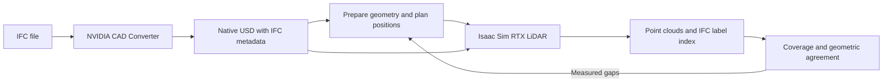

# RTX scan planning

An agent skill and Python workflow for planning, capturing and improving **IFC-linked synthetic LiDAR scans** with NVIDIA Isaac Sim. Version **0.7.0.4**.

The NVIDIA CAD Converter produces the USD and its native IFC metadata. This workflow chooses scanner positions, captures actual RTX sensor returns, measures coverage, and adds useful viewpoints. It preserves the converter's USD and links points to existing IFC identities.



## Give it to an agent

Clone this repository and ask the agent:

> Read SKILL.md. Check this machine's prerequisites, then use this IFC file to plan and capture scans. Preserve its native IFC identities, report coverage and remaining gaps, and refine the positions where useful.

For an agent with a skills directory, install the **whole repository folder**, not just `SKILL.md`, under the name `rtx-scan-planning`. The instructions, `runtime/`, `scripts/` and references must remain together. Codex invocation: `$rtx-scan-planning`. Other agents can read `SKILL.md` directly. No model API key is needed by the scan tools themselves.

## Prerequisites

| Component | Required setup |
|---|---|
| Supported machine | A system supported by the installed Isaac Sim release, with a working NVIDIA RTX GPU and driver. Windows x64, Linux x64 and DGX Spark are targets; there is no ARM-only check. Follow NVIDIA's [hardware and platform requirements](https://docs.isaacsim.omniverse.nvidia.com/latest/installation/requirements.html). |
| Isaac Sim | Install separately using NVIDIA's [installation instructions](https://docs.isaacsim.omniverse.nvidia.com/latest/installation/index.html). The capture code uses `SimulationApp`, `LidarRtx`, `GenericModelOutput`, `StableIdMap`, `get_gmo_data` and nonvisual material APIs. |
| Planning Python | Python **3.12**, a virtual environment, and `requirements.txt`. Warp uses the GPU for planning and measurement; this is not a CPU-only workflow. |
| CAD conversion | Needed for a new IFC import: a separate Python 3.12 environment with `requirements-cad.txt`. The official [NVIDIA CAD Converter](https://github.com/NVIDIA-Omniverse/usd-convert-cad) wheel includes its own USD runtime. |
| Data | An IFC file with usable physical geometry and identities, or a prepared native-CAD workbench dataset. The current reader expects the CAD converter's `omni:hoops:metadata:*` properties; arbitrary USD without IFC identity metadata is not equivalent input. |
| Storage | Local SSD/NVMe for environments, caches and captures. Precision captures can produce millions of returns per position; large jobs can need hundreds of GB or more. Preflight reports available disk space. There is no fixed scan-count cap. |

**Platform support versus test evidence:** full native captures and refinement were exercised on DGX Spark with Isaac Sim **5.1**, Python 3.12.3 for planning, OpenUSD 25.05, and CAD Converter 0.2.0. The setup below uses the publicly available CAD Converter 0.3.0, which supplies Windows and Linux wheels. The CLI checks its required options. New platforms and Isaac versions require the preflight and a small native capture; the existing scan evidence does not establish that every release has identical sensor APIs. NVIDIA now marks [Isaac Sim 5.1](https://docs.isaacsim.omniverse.nvidia.com/5.1.0/installation/install_workstation.html) as unsupported, so this tested version is evidence, not a requirement to replace a newer working installation.

The viewer is optional and is not bundled here. Point clouds can be consumed by another application; the local workbench uses OVStage/OVRTX for visualization. Isaac Lab, ROS, Blender and Cosmos are not required for this scanning workflow.

## Install on Linux

Install Isaac Sim separately first. Then run these commands from a local working disk:

```bash
git clone https://github.com/chrismcleodnvidia/rtx-scan-planning.git
cd rtx-scan-planning
python3.12 -m venv .venv
.venv/bin/python -m pip install -r requirements.txt

# Optional when reusing a prepared native-CAD dataset; required for new IFC import.
python3.12 -m venv .venv-cad
.venv-cad/bin/python -m pip install -r requirements-cad.txt

export BIMSCAN_PYTHON="$PWD/.venv/bin/python"
export BIMSCAN_CAD_PYTHON="$PWD/.venv-cad/bin/python"
export BIMSCAN_DATA="$PWD/work/data"
export ISAAC_SIM_PYTHON="/absolute/path/to/isaac-sim/python.sh"

"$BIMSCAN_PYTHON" scripts/preflight.py --gpu --isaac --cad --output work/preflight.json
```

## Install on Windows

Use PowerShell and an installed Python 3.12. The Isaac launcher is `python.bat` for a workstation installation:

```powershell
git clone https://github.com/chrismcleodnvidia/rtx-scan-planning.git
Set-Location rtx-scan-planning
py -3.12 -m venv .venv
& .\.venv\Scripts\python.exe -m pip install -r requirements.txt

py -3.12 -m venv .venv-cad
& .\.venv-cad\Scripts\python.exe -m pip install -r requirements-cad.txt

$env:BIMSCAN_PYTHON = "$PWD\.venv\Scripts\python.exe"
$env:BIMSCAN_CAD_PYTHON = "$PWD\.venv-cad\Scripts\python.exe"
$env:BIMSCAN_DATA = "$PWD\work\data"
$env:ISAAC_SIM_PYTHON = "C:\path\to\isaac-sim\python.bat"

& $env:BIMSCAN_PYTHON scripts/preflight.py --gpu --isaac --cad --output work/preflight.json
```

For a pip-installed Isaac Sim, `ISAAC_SIM_PYTHON` can instead name its configured environment's `python`/`python.exe`. Keep Isaac's Python version and packages appropriate to that Isaac release; do not install the planning requirements into it. For a container, run these commands **inside** the configured container, with the repository, data and GPU devices available there. `ISAAC_SIM_PYTHON` is an executable path, not a shell command such as `docker exec …`.

These environment variables apply to the current shell. Set them again in another shell or configure the agent's execution environment. Reuse compatible existing environments instead of overwriting them. Avoid installing multiple `pxr` providers in the same interpreter.

## Check before a large capture

`scripts/preflight.py` checks the selected interpreters, Python packages, output-directory access and available disk. Optional switches perform additional checks:

| Switch | Check |
|---|---|
| `--gpu` | Create and synchronize a real CUDA allocation through Warp. `nvidia-smi` alone is insufficient. |
| `--isaac` | Start headless Isaac Sim and verify the sensor API used by the capture script. It opens no customer scene and produces no scan. |
| `--cad` | Check CAD Converter imports and the CLI options needed for IFC ingestion. Omit for an already prepared dataset. |
| `--output FILE` | Save structured results for the agent. Exit code 1 identifies a failed check; omitted GPU/Isaac checks remain explicitly unverified. |

The first Isaac startup can populate shader/extension caches. `--timeout` controls the **preflight subprocess** timeout (300 seconds by default); it does not impose a conversion or scan time limit. For a new environment, complete a small native capture after preflight before launching a complex building. API availability alone is not proof of sensor output quality.

## First building

Run from `runtime/`, retaining the environment variables set above:

```bash
cd runtime
"$BIMSCAN_PYTHON" pipeline.py import /path/to/building.ifc --name Building
# Substitute the DATASET identifier printed by import.
"$BIMSCAN_PYTHON" pipeline.py plan DATASET --profile precision --exterior --elevated
"$BIMSCAN_PYTHON" pipeline.py scan DATASET --profile precision
```

PowerShell equivalent:

```powershell
Set-Location runtime
& $env:BIMSCAN_PYTHON pipeline.py import C:\data\building.ifc --name Building
& $env:BIMSCAN_PYTHON pipeline.py plan DATASET --profile precision --exterior --elevated
& $env:BIMSCAN_PYTHON pipeline.py scan DATASET --profile precision
```

Review the generated `plan.json` before capturing. For an installation smoke test, use a small asset or reviewed one-position plan. `preview` provides fewer beams; use the **same precision profile** for baseline/refinement comparisons. A stopped capture can be resumed with `pipeline.py scan DATASET --resume RUN_ID`.

Follow [the refinement commands](references/workflow.md) to measure existing coverage, select additional positions, capture just the additions, and combine compatible results. Planning samples and the retained coverage audit remain separate. The loop has no built-in scan-count ceiling.

## Outputs and boundaries

Each run contains native NPZ returns, PLY point clouds, `labels.json`, source/profile provenance, coverage audits, `metrics.json` and an HTML survey report. Label indices resolve to USD prim paths and IFC GlobalIds. The authoritative properties remain in native CAD USD. Display previews are downsampled; full-resolution returns are retained.

- Coverage means sampled surface locations with a same-IFC return within the requested distance. Visible and all-surface denominators are reported separately.
- Geometric agreement is measured against the supplied USD, not a calibrated real scanner or proof of IFC conversion fidelity.
- The tested baseline is opaque and zero-noise. Glass, transmission and manufacturer-specific response are not validated.
- The density predictor currently uses stationary, unrotated uniform angular grids. Other rigs need a corresponding predictor or measured candidate captures.
- Prepared datasets from the retired enrichment converter and their `ifc_usd` reader are outside this package's supported native-CAD input path.

Only reusable source and agent instructions are included. Install NVIDIA dependencies under their respective terms. No vendor SDK binaries, datasets, captured scans, credentials or internal project records are included.

## Troubleshooting

| Symptom | Action |
|---|---|
| Missing `pxr`, NumPy, SciPy, Warp or FileLock | Check `BIMSCAN_PYTHON`; install `requirements.txt` in that environment. |
| Missing `usd_convert_cad` or unsupported options | Check `BIMSCAN_CAD_PYTHON` and its `python -m usd_convert_cad --help`. |
| Missing sensor APIs after Isaac starts | Check the selected Isaac release and launcher; use the preflight output before changing environments. |
| CUDA context fails but `nvidia-smi` works | Check driver/device access, including container or sandbox GPU access. |
| No IFC identities | Confirm the standard conversion used `--convert-metadata`; arbitrary USD or a different metadata schema needs a compatible reader. |
| Slow first startup | Check the Isaac log for shader/extension setup. Keep caches and environments on local disk. |
| Capture interrupted | Retain the run and resume it; completed station checksums, source and profile are verified. |

## Reusable visualization and inspection

The workbench UI is not required. Optional additions in 0.7.0.4:

| Component | Input → output | Integration guide |
|---|---|---|
| Bounded preview | Full capture PLYs → point/label arrays and explicit sampling counts | [Visualization](references/visualization.md) |
| All-return offline views | Full capture + cameras → PNGs and processing record | [Visualization](references/visualization.md) |
| IFC-aware inspection | Native CAD USD + picked prim/scan label → IFC owner; IFC owner → renderable meshes | [Application integration](references/application-integration.md) |

For the renderer and viewer foundation use the [official NVIDIA Realtime Viewer skill](https://github.com/NVIDIA/skills/blob/main/skills/omniverse-realtime-viewer/SKILL.md). The [Omniverse Libraries Playground](https://github.com/NVIDIA-Omniverse/omniverse-labs/tree/main/samples/ov-library-playground-sample) is the specific walkthrough reference. The [Blender 0.2 integration](https://github.com/NVIDIA-Omniverse/omniverse-labs/releases/tag/ovrtx-blender-example-0.2) shows an existing host application's external rendering-worker architecture. These are upstream references, not repackaged implementations or a claim of tested customer-application integration.
