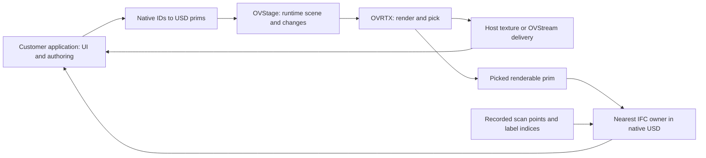

# Integrating scan inspection into an existing application

The customer application remains the host. This package supplies optional scan/IFC helpers, not a replacement UI or a customer-specific RTX plugin. A browser-streamed reference application does not establish that embedding in another host is validated.

## Reuse existing NVIDIA components first

| Need | Start here | What this package adds |
|---|---|---|
| RTX viewer, OVStage ownership, camera/picking, streaming and UI integration | [Official Omniverse Realtime Viewer skill](https://github.com/NVIDIA/skills/blob/main/skills/omniverse-realtime-viewer/SKILL.md), its [camera controls](https://github.com/NVIDIA/skills/blob/main/skills/omniverse-realtime-viewer/references/camera-controls/README.md) and [native picking/selection](https://github.com/NVIDIA/skills/blob/main/skills/omniverse-realtime-viewer/references/native-picking-selection/README.md) | IFC identity resolution, mesh ownership and scan-label associations; no duplicate renderer or transport framework. |
| A concrete walkthrough controller | [Omniverse Libraries Playground](https://github.com/NVIDIA-Omniverse/omniverse-labs/tree/main/samples/ov-library-playground-sample), especially [navigation.py](https://github.com/NVIDIA-Omniverse/omniverse-labs/blob/main/samples/ov-library-playground-sample/source/nvidia/ov_library_lab/navigation.py) | Scan stations can supply candidate entry/viewpoint positions. No copied walking engine. |
| RTX embedded in an existing authoring application | [Blender example 0.2 release](https://github.com/NVIDIA-Omniverse/omniverse-labs/releases/tag/ovrtx-blender-example-0.2), [architecture](https://github.com/NVIDIA-Omniverse/omniverse-labs/blob/main/projects/ov-blender-example/docs/architecture.md), [developer guide](https://github.com/NVIDIA-Omniverse/omniverse-labs/blob/main/projects/ov-blender-example/docs/developer-guide.md) | A reference integration boundary, not a tested adapter for the customer's application. |
| General renderer setup and still-image output | [OVRTX](https://github.com/NVIDIA-Omniverse/ovrtx), its [skills](https://github.com/NVIDIA-Omniverse/ovrtx/tree/main/skills) and the official viewer skill | Optional all-return point projection and preview accounting described in [visualization.md](visualization.md). |

Reviewed against public sources on 2026-11-12. Blender release tag `ovrtx-blender-example-0.2` was published 2026-11-06. Main-branch documentation may evolve; use the release's matching runtime, platform and license requirements. No vendor SDK or example code is bundled here.

The official Viewer skill already covers orbit/pan/fly and navigation presets. The playground is specifically a ready-made walking example: its Walker has planar movement, obstacle tests and substeps. Its campus layout and Y-up conventions are not an arbitrary-building navigation solution. For imported IFC, supply building-specific floor/obstacle information, up-axis, units and entry positions; test stairs and level changes separately. Do not describe a fixed-height free camera as collision-aware walking. The reviewed playground lists Windows as tested; that is not a cross-platform qualification of its complete application.

## Lessons from Blender 0.2: boundaries, not a new framework

- Keep the customer's authoring model and stable native identities authoritative. Maintain a mapping to USD prim paths for the currently loaded scene generation; a UI selection must not silently substitute a different edit target.
- Isolate native SDK dependencies in a compatible external runtime where appropriate. Blender's add-on/runtime architecture demonstrates this option; it is not proof that every host must use a separate process.
- Separate scene/runtime lifetime from individual viewport panes. Closing one pane should not accidentally destroy another pane's rendering state.
- Serialize updates and rendering through the runtime owner. Coalesce superseded camera/transform updates instead of rebuilding the complete stage on each UI event.
- Keep authoring changes, renderer acceptance and frame presentation distinct. Recover a failed worker/transport without silently losing the host's desired state.
- Treat viewport display and final image output as separate contracts. Blender 0.2 documents LDR/HDR output and restart/reconnect controls; adopt the upstream mechanisms rather than cloning them into this skill.

The 0.2 release lists Windows x64 and Linux x64 packages, Blender 5.2.1 LTS, and unsupported ARM/macOS packages. It supports a subset of Blender materials and one LDR/HDR output at a time. These are that example's limits, not blanket limitations of the Omniverse libraries. We have inspected this integration; we have not executed its 0.2 package or embedded RTX in a Nemetschek application.



## IFC-specific inspection helpers

Use `runtime/ifc_inspection.py` with the planning Python environment. It reuses the existing native CAD metadata reader; no original IFC or enriched exporter is required for lookup.

```bash
python runtime/ifc_inspection.py --usd building.usdc --prim /Asset/Wall/Shape
python runtime/ifc_inspection.py --usd building.usdc --labels capture/labels.json --scan-label 12
python runtime/ifc_inspection.py --usd building.usdc --mesh-index --output mesh-owners.json
```

The optional output index is a rebuildable application cache, not another authoritative BIM file. Applications can call `nearest_owner`, `mesh_index`, and `scan_owner` directly and keep their own in-memory caches. The CLI reads native USD metadata once per invocation; an interactive host should retain it by USD revision rather than invoking it on every click.

For two-way selection:

1. A viewport pick returns a renderable prim path. Resolve its nearest IFC ancestor; display that object's existing USD properties.
2. A scan point contains a label index. Resolve it through the matching capture label table to its IFC GlobalId.
3. An inspector selection provides that GlobalId. Highlight all mapped renderable meshes and the corresponding displayed scan-point group.

Bind labels to the matching source revision and invalidate caches when the USD changes. Matching a GlobalId alone does not prove that geometry revisions match. The supplied reader targets native NVIDIA CAD-converter metadata, not every possible USD IFC schema. Extend the identity reader for other exporters; do not require a new export merely to change the inspector.

Renderer integration detail: selection groups apply to renderable prims. Assigning them only to IFC parent Xforms can leave the geometry uncoloured. `mesh_index` resolves nearest owners, including nested IFC children. For per-class fill colours use the installed OVRTX selection-fill API (`SelectionFillMode.GROUP_FILL_COLOR` in the tested API), not its default global fill. Keep materials, white display and class colour display mutually exclusive in the host UI. This uses existing renderer capability; it is not a new material system.

## Small host integration check

In the target application, verify one loaded USD, one camera move, one native object edit, one pick resolving to IFC properties, one inspector-to-viewport selection, and closing/reopening a viewport. Then test worker recovery and a second model. These checks remain to be done in the customer's application; the supplied CLI tests and browser reference do not replace them.
